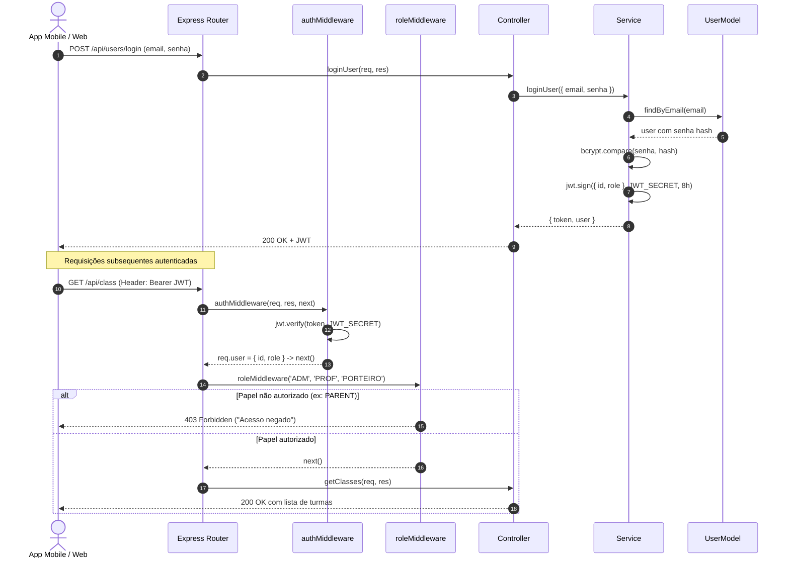

# 🏛️ Arquitetura do Sistema e Guia de Confiabilidade & QA - BipEscola

> **BipEscola**: Sistema de Controle de Entrada, Saída e Presença Escolar com Suporte a Chamada Manual e QR Code.  
> **Documento Técnico**: Arquitetura de Software, Fluxo de Dados, Modelo de Segurança, Mapeamento de Regras e Guia de Testes Automatizados.

---

## 📑 Sumário Executivo
1. [Visão Geral & Estilo Arquitetural](#-1-visão-geral--estilo-arquitetural)
2. [Diagramas de Fluxo de Dados](#-2-diagramas-de-fluxo-de-dados)
3. [Segurança & Controle de Acesso (RBAC)](#-3-segurança--controle-de-acesso-rbac)
4. [Diagnóstico e Mapeamento de Endpoints & Regras](#-4-diagnóstico-e-mapeamento-de-endpoints--regras)
5. [Estratégia de Confiabilidade & Tratamento de Erros](#-5-estratégia-de-confiabilidade--tratamento-de-erros)
6. [Guia de Execução da Suíte de Testes](#-6-guia-de-execução-da-suíte-de-testes)
7. [Relatório de Cobertura de Código (Quality Gate)](#-7-relatório-de-cobertura-de-código-quality-gate)

---

## 🔍 1. Visão Geral & Estilo Arquitetural

O backend do **BipEscola** adota uma **Arquitetura em Camadas (Layered Architecture)** baseada em princípios de separação de responsabilidades (SoC), garantindo testabilidade, manutenção simplificada e baixo acoplamento entre a camada HTTP e o acesso a dados.

```
                    ┌───────────────────────────────┐
                    │  Clientes (Mobile Expo, Web)  │
                    └───────────────┬───────────────┘
                                    │ HTTP / JSON
                                    ▼
                    ┌───────────────────────────────┐
                    │      app.js (Express 5)       │
                    │   - CORS, JSON Body Parser    │
                    │   - Global 404 & Error Handler│
                    └───────────────┬───────────────┘
                                    │
                    ┌───────────────▼───────────────┐
                    │       src/routes/*.js         │
                    │   - Definição de endpoints    │
                    │   - Middlewares de Auth/Role  │
                    └───────────────┬───────────────┘
                                    │
                    ┌───────────────▼───────────────┐
                    │     src/controllers/*.js      │
                    │   - Validação de entrada      │
                    │   - Tratamento de status HTTP │
                    └───────────────┬───────────────┘
                                    │
                    ┌───────────────▼───────────────┐
                    │      src/services/*.js        │
                    │   - Regras de negócio centrais│
                    │   - Hashing, JWT, Cálculos    │
                    └───────────────┬───────────────┘
                                    │
                    ┌───────────────▼───────────────┐
                    │       src/models/*.js         │
                    │   - Abstração SQL parametrizada│
                    │   - Mapeamento objeto-relacional│
                    └───────────────┬───────────────┘
                                    │
                    ┌───────────────▼───────────────┐
                    │       src/database/db.js      │
                    │   - Pool de Conexões MySQL 2  │
                    └───────────────────────────────┘
```

### Camadas do Sistema:
- **`app.js`**: Ponto central de configuração da aplicação Express, middlewares globais (CORS, parser de corpo JSON), roteamento centralizado, tratamento global de rotas não mapeadas (404 JSON) e middleware centralizado de exceções.
- **`src/middlewares/`**: Validações de pré-processamento de requisições:
  - `authMiddleware.js`: Valida o formato `Bearer <token>`, decodifica o JWT e anexa `req.user`.
  - `roleMiddleware.js`: Autoriza o acesso com base nos papéis (`ADM`, `PROF`, `PARENT`, `PORTEIRO`).
- **`src/controllers/`**: Recebe `req` e `res`, faz sanitização e validação inicial de tipos (`Number.isInteger`, strings obrigatórias), invoca o serviço correspondente e responde com o código HTTP adequado (200, 201, 400, 401, 403, 404, 409, 500).
- **`src/services/`**: Implementa as regras de negócio puras (geração de credenciais temporárias, verificação de duplicidade, cálculo de taxas de presença, envio de e-mails via Nodemailer, regras de visibilidade de avisos).
- **`src/models/`**: Executa queries SQL parametrizadas via `mysql2/promise`, prevenindo SQL Injection.
- **`src/database/db.js`**: Gerencia o pool de conexões MySQL com liberação automática de conexões (`connection.release()` no bloco `finally`).

---

## 📊 2. Diagramas de Fluxo de Dados

### 2.1. Fluxo de Autenticação e Autorização RBAC



### 2.2. Fluxo de Registro e Consulta de Presenças

```mermaid
flowchart TD
    A["Chamada / Portaria (App)"] -->|"POST /api/attendances<br/>{ aluno_id, data, presente }"| B["attendanceRoutes"]
    B -->|"Valida JWT"| C{"authMiddleware"}
    C -->|Inválido/Ausente| C1["401 Token não informado"]
    C -->|Válido| D{"roleMiddleware<br/>(ADM, PROF, PORTEIRO)"}
    D -->|Não autorizado| D1["403 Acesso negado"]
    D -->|Autorizado| E["attendanceController.createAttendance"]
    E -->|"Validação de payload"| F{"aluno_id, data, presente válidos?"}
    F -->|Não| F1["400 Erro de validação"]
    F -->|Sim| G["attendanceService.markAttendance"]
    G --> H["attendanceModel.createAttendance"]
    H -->|"INSERT INTO presencas"| I[(MySQL DB)]
    I -->|Violação UNIQUE (aluno_id, data)| J["ER_DUP_ENTRY -> 409 Conflict"]
    I -->|Sucesso| K["201 Created + Dados da Presença"]
```

---

## 🔒 3. Segurança & Controle de Acesso (RBAC)

O sistema opera sob quatro papéis fundamentais (*Roles*):

| Role | Descrição | Escopo de Acesso |
|---|---|---|
| **`ADM`** | Administrador do Sistema | Acesso total e irrestrito. Único que pode excluir usuários, turmas, alunos e presenças. Não pode auto-excluir a própria conta. |
| **`PROF`** | Professores e Coordenadores | Gerencia chamadas, consulta histórico de frequências, cria e edita comunicados gerais e por aluno, visualiza turmas. |
| **`PORTEIRO`** | Operador de Portaria / Entrada | Registra entradas e saídas de alunos (presença por QR Code ou manual) e consulta turmas/histórico de registros. |
| **`PARENT`** | Responsáveis pelos Alunos | Acesso restrito aos dados dos seus próprios filhos (`/api/students/pai/:id`), visualização de avisos gerais ou direcionados a si. |

---

## 📋 4. Diagnóstico e Mapeamento de Endpoints & Regras

| Módulo | Método | Rota | Autenticação / Roles | Regras de Negócio e Validações |
|---|---|---|---|---|
| **Raiz** | `GET` | `/` | Público | Retorna mensagem de status e boas-vindas `{ msg: "Bem-vindo" }`. |
| **Autenticação** | `POST` | `/api/users/login` | Público | Valida email e senha com hash bcrypt. Retorna JWT com expiração de 8h e dados do perfil. |
| **Usuários** | `POST` | `/api/users` | Público | Cria usuário com senha temporária aleatória de 8 caracteres; hash com salt 10. |
| **Usuários** | `GET` | `/api/users` | Público | Lista todos os usuários sem expor a coluna `senha`. |
| **Usuários** | `GET` | `/api/users/:id` | Público | Valida `id` numérico inteiro. Retorna 404 caso não encontrado. |
| **Usuários** | `PUT` | `/api/users/:id` | Público | Valida obrigatoriedade de `nome` e `email`. Atualiza dados cadastrais. |
| **Usuários** | `DELETE` | `/api/users/:id` | `ADM` | Exclui usuário. Impede explicitamente a auto-exclusão do ADM autenticado (403). |
| **Senha** | `PUT` | `/api/users/change-password` | Autenticado | Exige `senhaAtual` e `novaSenha` (mínimo 8 caracteres). Valida senha antiga antes de atualizar. |
| **Senha** | `POST` | `/api/users/forgot-password` | Público | Gera token criptográfico (32 bytes hex) com expiração em 1h. Emite email via SMTP ou log seguro em dev. |
| **Senha** | `POST` | `/api/users/reset-password` | Público | Valida token não expirado e atualiza senha com hash bcrypt. Invalida o token após uso. |
| **Foto** | `PUT` | `/api/users/:id/photo` | Autenticado | Usuário comum só pode atualizar a própria foto; ADM pode atualizar foto de qualquer usuário. |
| **Turmas** | `POST` | `/api/class` | `ADM` | Nome obrigatório e único. Cria turma ativa no sistema. |
| **Turmas** | `GET` | `/api/class` | `ADM`, `PROF`, `PORTEIRO` | Lista turmas ativas e inativas. Disponível também pelos aliases `/api/classes` e `/api/turmas`. |
| **Turmas** | `GET` | `/api/class/:id` | `ADM`, `PROF`, `PORTEIRO` | Retorna detalhes da turma por ID numérico. |
| **Turmas** | `PUT` | `/api/class/:id` | `ADM` | Permite alterar nome e status (`ativa`/`inativa`). |
| **Turmas** | `DELETE` | `/api/class/:id` | `ADM` | Remove turma existente caso não haja impedimento relacional. |
| **Alunos** | `POST` | `/api/students` | Público | Exige `matricula`, `nome` e `turma_id`. `id_pai` opcional validado como inteiro se fornecido. |
| **Alunos** | `GET` | `/api/students` | Público | Lista todos os alunos ordenados por nome com join no nome da turma. |
| **Alunos** | `GET` | `/api/students/:id` | Público | Busca aluno por ID. Retorna 404 se não encontrado. |
| **Alunos** | `GET` | `/api/students/pai/:id` | Público | Lista apenas os alunos dependentes do responsável informado. |
| **Alunos** | `GET` | `/api/students/turma/:id`| Público | Lista alunos matriculados na turma informada. |
| **Alunos** | `PUT` | `/api/students/:id` | Público | Valida existência do aluno e atualiza dados cadastrais e faltas. |
| **Alunos** | `DELETE` | `/api/students/:id` | Público | Remove o aluno do sistema. |
| **Presenças** | `POST` | `/api/attendances` | `ADM`, `PROF`, `PORTEIRO` | Registra presença diária. Trata conflito de duplicidade (mesmo aluno no mesmo dia) com HTTP 409. |
| **Presenças** | `GET` | `/api/attendances/historico` | `ADM`, `PROF`, `PORTEIRO` | Filtra por data, intervalo, aluno, turma e presente. Retorna métricas calculadas e taxa de comparecimento. |
| **Presenças** | `GET` | `/api/attendances/aluno/:id` | Autenticado | Retorna histórico de frequências do aluno. |
| **Presenças** | `GET` | `/api/attendances/data/:data` | Autenticado | Retorna lista de chamadas registradas na data especificada. |
| **Presenças** | `GET` | `/api/attendances/:id` | Autenticado | Retorna presença específica por ID. |
| **Presenças** | `PUT` | `/api/attendances/:id` | `ADM`, `PROF` | Atualiza status de presença ou data do registro. |
| **Presenças** | `DELETE` | `/api/attendances/:id` | `ADM` | Exclusão restrita a administradores. |
| **Avisos** | `POST` | `/api/posts` | `ADM`, `PROF` | Cria aviso geral (`destinatario_id` null/'todos') ou direcionado a um responsável específico (`PARENT`). |
| **Avisos** | `GET` | `/api/posts` | Autenticado | Usuário `PARENT` recebe apenas avisos gerais ou direcionados a si. `ADM` e `PROF` veem todos. |
| **Avisos** | `GET` | `/api/posts/:id` | Autenticado | Bloqueia visualização se o aviso for direcionado a outro `PARENT` (retorna 404 por segurança). |
| **Avisos** | `PUT` | `/api/posts/:id` | `ADM`, `PROF` | Somente o autor original ou um ADM pode editar o aviso. |
| **Avisos** | `DELETE` | `/api/posts/:id` | `ADM`, `PROF` | Somente o autor original ou um ADM pode excluir o aviso. |
| **Gestão Roles** | `*` | `/api/adms`, `/api/professors`, `/api/parents` | Diversos | Endpoints de conveniência para cadastro e listagem tipada por papel. |

---

## 🛡️ 5. Estratégia de Confiabilidade & Tratamento de Erros

1. **Middleware Global 404**:
   - Qualquer rota HTTP não mapeada retorna um payload padronizado em JSON com status 404:
     ```json
     { "error": "Rota não encontrada" }
     ```
2. **Middleware Centralizado de Erros**:
   - Captura exceções não tratadas e erros de parsing (ex: JSON malformado enviado no corpo da requisição):
     ```json
     { "error": "Unexpected token... in JSON at position..." }
     ```
3. **Resiliência do Pool de Conexões**:
   - Uso de `connection?.release()` em blocos `finally` estritos no módulo de banco de dados (`db.js`), impedindo vazamento de conexões (*connection leaks*).
4. **Isolamento de Testes**:
   - Todos os testes de integração e unitários utilizam mocks determinísticos de banco de dados e serviços com ESM nativo (`jest.unstable_mockModule`), permitindo execução rápida e independente em ambientes de CI/CD sem necessidade de banco de dados local ligado.

---

## 🧪 6. Guia de Execução da Suíte de Testes

### Pré-requisitos
Certifique-se de que as dependências do backend estão instaladas:
```bash
cd backend
npm install
```

### Comandos de Teste

| Comando | Descrição |
|---|---|
| `npm test` | Executa todos os testes unitários e de integração em modo ESM nativo. |
| `npm run test:coverage` | Executa a suíte completa gerando o relatório tabular e detalhado de cobertura de código. |
| `npm run test:watch` | Executa os testes em modo interativo de observação (ideal para desenvolvimento TDD). |

### Executando Testes Específicos
Para rodar apenas uma categoria ou arquivo de teste:
```bash
# Apenas testes unitários
npm test -- tests/unit/

# Apenas testes de integração
npm test -- tests/integration/

# Teste de um módulo específico
npm test -- tests/integration/attendances.integration.test.js
```

---

## 📈 7. Relatório de Cobertura de Código (Quality Gate)

A suíte conta com **17 suítes de testes** e **233 testes automatizados**, atingindo **100% de sucesso**.

```
--------------------------|---------|----------|---------|---------|-------------------
File                      | % Stmts | % Branch | % Funcs | % Lines | Status
--------------------------|---------|----------|---------|---------|-------------------
All files                 |   96.13 |    86.02 |     100 |   96.10 | ✅ Meta > 80% Superada
 backend (app.js)         |     100 |    33.33 |     100 |     100 | ✅ 100% Linhas
 backend/src/controllers  |   93.22 |    86.03 |     100 |   93.14 | ✅ Excelente
  admController.js        |     100 |    92.30 |     100 |     100 | ✅ 100% Linhas
  attendanceController.js |   89.65 |    83.87 |     100 |   89.65 | ✅ > 89% Linhas
  classController.js      |     100 |    88.88 |     100 |     100 | ✅ 100% Linhas
  parentController.js     |     100 |    90.90 |     100 |     100 | ✅ 100% Linhas
  postController.js       |   84.61 |    86.66 |     100 |   84.12 | ✅ > 84% Linhas
  studentController.js    |   86.66 |    81.25 |     100 |   86.66 | ✅ > 86% Linhas
  teacherController.js    |     100 |    92.30 |     100 |     100 | ✅ 100% Linhas
  userController.js       |   93.81 |    83.11 |     100 |   93.81 | ✅ > 93% Linhas
 backend/src/database     |     100 |    50.00 |     100 |     100 | ✅ 100% Linhas
 backend/src/middlewares  |     100 |      100 |     100 |     100 | ✅ 100%
 backend/src/models       |     100 |    87.17 |     100 |     100 | ✅ 100%
 backend/src/routes       |     100 |      100 |     100 |     100 | ✅ 100%
 backend/src/services     |     100 |    97.67 |     100 |     100 | ✅ 100%
--------------------------|---------|----------|---------|---------|-------------------
Total Test Suites: 17 passed / 17 total (100%)
Total Tests:       233 passed / 233 total (100%)
Tempo Médio:       ~7.2 segundos
```
