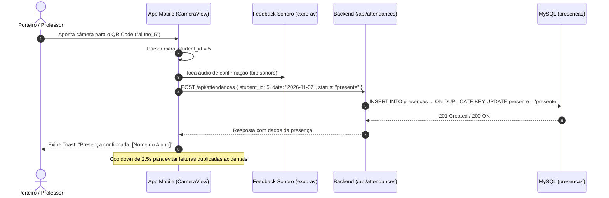
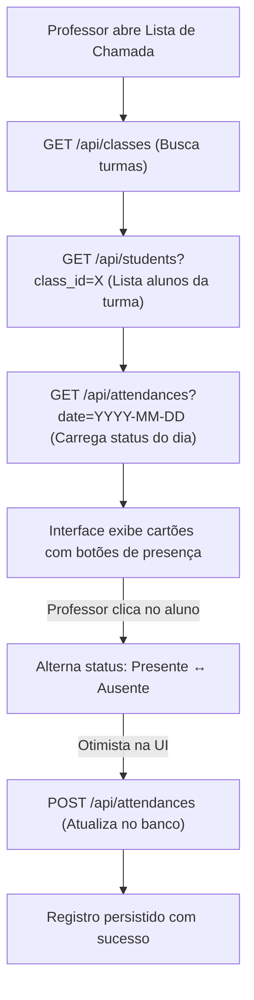

# 📋 Métodos de Registro e Acompanhamento de Presença - BipEscola

> **BipEscola**: Documentação técnica e operacional dos métodos de registro e consulta de presença escolar (QR Code, Chamada Manual e Histórico).

---

## 📌 Sumário
1. [Visão Geral dos Métodos](#1-visão-geral-dos-métodos)
2. [Método 1: Leitura de QR Code (Portaria / Entrada Rápida)](#2-método-1-leitura-de-qr-code-portaria--entrada-rápida)
3. [Método 2: Chamada Manual por Turma (Sala de Aula / Coordenação)](#3-método-2-chamada-manual-por-turma-sala-de-aula--coordenação)
4. [Acompanhamento e Histórico de Presença](#4-acompanhamento-e-histórico-de-presença)
5. [Contratos de API e Persistência no Banco](#5-contratos-de-api-e-persistência-no-banco)
6. [Tratamento de Fuso Horário (Timezone BRT)](#6-tratamento-de-fuso-horário-timezone-brt)

---

## 1. Visão Geral dos Métodos

O **BipEscola** oferece flexibilidade operacional permitindo que o registro de presença seja realizado por meio de duas abordagens complementares, ambas integradas à mesma tabela e regras de negócio:

| Característica | 📷 Leitura de QR Code | 📝 Chamada Manual por Turma |
|---|---|---|
| **Tela no App** | `mobile/src/pages/Presence/QRCodeScannerScreen.js` | `mobile/src/pages/Presence/ClassListScreen.js` |
| **Público Principal** | Portaria (`PORTEIRO`), Inspetores e Professores | Professores (`PROF`) e Administradores (`ADM`) |
| **Cenário de Uso** | Entrada e recepção dos alunos na portaria | Sala de aula, conferência de início do turno |
| **Tempo Médio** | Instantâneo (~1 segundo por aluno) | Rápido (~1 toque por aluno na lista) |
| **Hardware Necessário** | Câmera do smartphone/tablet | Apenas tela sensível ao toque / dispositivo móvel |
| **Feedback ao Usuário** | Som de "bip" (`expo-av`) + Toast com nome do aluno | Alternância visual imediata (Badge Verde/Vermelho) |
| **Endpoint Consumido** | `POST /api/attendances` | `POST /api/attendances` |

---

## 2. Método 1: Leitura de QR Code (Portaria / Entrada Rápida)

### 2.1. Como Funciona
Cada crachá ou carteirinha do aluno possui um QR Code codificado no padrão institucional:
- **Padrão Primário**: `aluno_<ID>` (exemplo: `aluno_1`, `aluno_42`)
- **Padrão Numérico Direto**: `<ID>` (exemplo: `1`, `42`)

O operador (porteiro ou professor) aponta a câmera do aplicativo para o código do aluno. O app decodifica o identificador, extrai o `student_id` e envia a requisição de presença para o backend.

### 2.2. Fluxo de Execução


### 2.3. Resiliência e Prevenção de Falhas
- **Cooldown de Varredura**: Após o disparo de uma leitura com sucesso, a câmera entra em pausa de 2,5 segundos antes de aceitar a leitura do próximo aluno.
- **Tratamento de Duplicidade**: Se o aluno já teve a presença registrada no mesmo dia, o backend atualiza o registro ou responde com confirmação idempotente, evitando erro 409 ou tela travada.
- **Formato Inválido**: Códigos QR desconhecidos que não seguem o formato de aluno geram um alerta amigável na tela informando que o código não pertence ao sistema.

---

## 3. Método 2: Chamada Manual por Turma (Sala de Aula / Coordenação)

### 3.1. Como Funciona
Ideal para o professor em sala de aula ao iniciar ou finalizar o período letivo:
1. O professor seleciona a sua turma em um seletor visual (dropdown ou abas de turmas cadastradas).
2. O aplicativo lista todos os alunos vinculados àquela turma com seus respectivos avatares e matrículas.
3. Para a data selecionada (por padrão a data atual no fuso local), o app já traz pré-carregado o status atual de cada estudante (`presente` ou `ausente`).
4. Com um único toque (**1-Tap**), o professor alterna o status do aluno entre presente e ausente.

### 3.2. Fluxo de Execução


---

## 4. Acompanhamento e Histórico de Presença

### 4.1. Para a Escola (Administradores, Professores e Portaria)
A tela `AttendanceHistoryScreen` permite:
- Filtrar presenças por data específica (seletor de calendário).
- Filtrar por aluno ou turma.
- Visualizar taxa percentual de comparecimento do dia.
- Identificar rapidamente ausências para contato imediato com os responsáveis.

### 4.2. Para os Responsáveis (`PARENT`)
Ao acessar o aplicativo com perfil de responsável:
- O responsável visualiza apenas o histórico dos seus dependentes cadastrados (filtrados via `/api/students/pai/:id`).
- Recebe a confirmação de horário de entrada do filho na escola.
- Consulta o histórico de frequências do mês corrente.

---

## 5. Contratos de API e Persistência no Banco

### 5.1. Rota de Registro de Presença
- **Método**: `POST`
- **URL**: `/api/attendances`
- **Headers**: `Authorization: Bearer <JWT>`
- **Permissões**: `ADM`, `PROF`, `PORTEIRO`
- **Corpo da Requisição (Payload)**:
```json
{
  "student_id": 1,
  "date": "2026-11-07",
  "status": "presente",
  "notes": "Entrada via QR Code na portaria principal"
}
```
- **Resposta de Sucesso (HTTP 201 / 200)**:
```json
{
  "message": "Presença registrada com sucesso",
  "data": {
    "id": 154,
    "aluno_id": 1,
    "data": "2026-11-07",
    "presente": "presente",
    "observacoes": "Entrada via QR Code na portaria principal",
    "data_criacao": "2026-11-07T10:30:00.000Z"
  }
}
```

### 5.2. Estrutura da Tabela no MySQL (`presencas`)
```sql
CREATE TABLE IF NOT EXISTS presencas (
  id INT AUTO_INCREMENT PRIMARY KEY,
  aluno_id INT NOT NULL,
  data DATE NOT NULL,
  presente ENUM('presente', 'ausente') DEFAULT 'presente',
  observacoes VARCHAR(255) NULL,
  data_criacao TIMESTAMP DEFAULT CURRENT_TIMESTAMP,
  data_atualizacao TIMESTAMP DEFAULT CURRENT_TIMESTAMP ON UPDATE CURRENT_TIMESTAMP,
  FOREIGN KEY (aluno_id) REFERENCES alunos(id) ON DELETE CASCADE,
  UNIQUE KEY uq_aluno_data (aluno_id, data)
) ENGINE=InnoDB DEFAULT CHARSET=utf8mb4 COLLATE=utf8mb4_unicode_ci;
```

---

## 6. Tratamento de Fuso Horário (Timezone BRT)

> [!IMPORTANT]
> O BipEscola utiliza estritamente o utilitário compartilhado [`getLocalDateString()`](file:///mobile/src/shared/utils/dateUtils.js) em todas as telas de chamada e histórico do aplicativo mobile.

### O Problema do `toISOString()`
Em sistemas rodando no fuso horário do Brasil (UTC-3), o método JavaScript padrão `.toISOString().split('T')[0]` gera a data do dia seguinte a partir das 21:00 BRT (pois `21:00 BRT` = `00:00 UTC` do dia subsequente). Isso fazia com que uma chamada noturna ou registros após as 21h fossem gravados incorretamente no dia de amanhã.

### A Solução Implementada
A função `getLocalDateString(d = new Date())` extrai o ano, mês e dia locais com `getFullYear()`, `getMonth() + 1` e `getDate()`, formatando deterministicamente como `YYYY-MM-DD` de acordo com a data local do dispositivo, eliminando 100% dos erros de data incorreta.
